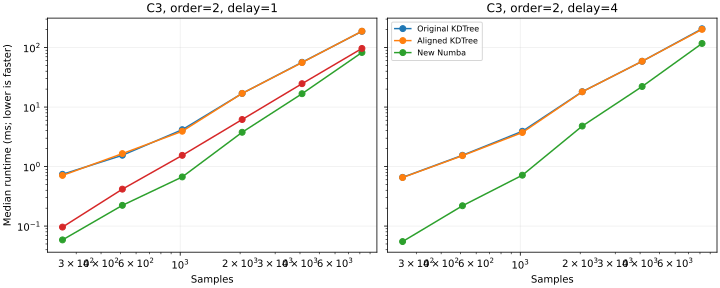

# Resting EEG benchmark

Three channels (C3, Cz, O1), first 30 seconds of the NeuroKit resting EEG example,
300 Hz, orders 2 and 3, delays 1, 2, 4 and 8, tolerance = 0.2 × segment standard deviation.
See [data provenance](../data/README.md) and [machine and timing details](environment.json).
Times include the public Python wrappers; compilation and warm-up are excluded.
Each timing is the median of 7 calls in randomized method order.
These are measurements on one recording and one machine, not universal speed guarantees.

## Speedup by segment length

Each entry is the median baseline/new-runtime ratio across channels, orders and delays.
A ratio greater than 1 means the new implementation is faster.
The original Numba comparison uses delay=1 only, because it has no delay support.

| Samples | Original KDTree / new | Aligned KDTree / new | Original Numba / new (delay=1) |
| ---: | ---: | ---: | ---: |
| 256 | 11.81× | 11.56× | 1.59× |
| 512 | 6.09× | 5.99× | 1.48× |
| 1024 | 5.45× | 5.45× | 2.17× |
| 2048 | 4.29× | 4.26× | 1.84× |
| 4096 | 3.43× | 3.40× | 1.77× |
| 8192 | 2.41× | 2.44× | 1.26× |

Original KDTree: overall median speedup 5.07×; new implementation faster in 144/144 cases; range 1.74–14.14×.

Original Numba (delay=1): overall median speedup 1.59×; new implementation faster in 34/36 cases; range 0.87–3.37×.

## Correctness and interpretation

All 144 empirical configurations matched the aligned KDTree reference
(maximum absolute entropy difference: 0).
At delay=1, results also matched both original implementations.
For delay>1, the maximum difference from the unchanged original KDTree output was 0.0595791.
That difference comes from the original function using unequal numbers of order-m and order-(m+1) templates.
The new function uses the same extendable start indices for both dimensions.



The figure shows C3, order=2; the table aggregates all tested channels, orders and delays.
Raw per-configuration medians and quartiles are in [timings.csv](timings.csv).

Reproduce from the repository root:

```sh
python examples/benchmark_resting_eeg.py
python examples/summarize_benchmark.py
```
