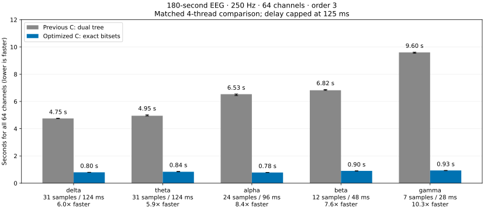

# Faster sample entropy for 180-second EEG segments

Input: **64 channels × 45,000 samples**, 250 Hz, order=3, tolerance=0.2 × each filtered channel SD.
Both methods use **4 threads** on the same cloud machine.
Delays are round(250 / band midpoint), capped at floor(250 × 0.125) = **31 samples (124 ms)**.
The generic entropy function accepts integer delays; this application-level cap is applied by the benchmark.
Timings are whole-batch medians of 3 calls; method order is randomized.
File reading, resampling, band filtering and library/OpenMP warm-up are excluded.
Input validation, radius calculation, allocations and complete entropy/count computation are included.

| Band | Hz | Delay (samples) | Delay (ms) | Previous C dual tree (s) | Optimized C auto (s) | Speedup |
| --- | --- | ---: | ---: | ---: | ---: | ---: |
| delta | 0.5–4 | 31 | 124 | 4.751 | 0.798 | **5.96×** |
| theta | 4–8 | 31 | 124 | 4.952 | 0.838 | **5.91×** |
| alpha | 8–13 | 24 | 96 | 6.533 | 0.782 | **8.36×** |
| beta | 13–30 | 12 | 48 | 6.823 | 0.902 | **7.56×** |
| gamma | 30–45 | 7 | 28 | 9.604 | 0.934 | **10.28×** |

## Exactness

The order-3 bitset method and the previous dual-tree method produced **identical uint64 pair counts**
for both embedding dimensions on all 320 channel/band combinations. Entropy values also matched exactly
in this run. Every timed call checked both count arrays and the entropy vector with exact array comparison.
An independent aligned sklearn KDTree calculation additionally verified both C3 counts in every band.
The raw [count vectors](counts.json) are retained. This is stronger than checking approximately equal logarithms.
Cross-platform floating-point logarithms need not be bit-identical; no universal cross-platform claim is implied.

## Algorithm

Profiling the previous C code on the 180-second alpha C3 segment attributed about 96% of sampled runtime
to recursive pair counting. The [profile](profile.txt) used GCC -O3 -pg -fno-inline; profiling timings are
not the throughput timings reported above.

The new method reindexes templates by their first coordinate, so only a contiguous forward radius window
must be checked. Prefix bitsets describe radius neighborhoods in the other coordinates. Partial blocks
are corrected exactly with XOR; integer word intersections and population counts yield the same matches.
POPCNT is selected only when the x86 CPU supports it; a tested portable path remains available.
No approximate matching, template subsampling or fast-math is used.

`algorithm="auto"` selects bitsets for order=3 and 32,768–65,536 input samples, including this 45,000-sample workflow.
`algorithm="bitset"` selects it explicitly; `algorithm="tree"` retains the previous method.
Order=2 retains its range counter, and other automatic cases retain the dual tree.
Prefix storage grows quadratically with a compact bit-packed constant; the automatic size limit bounds memory.
At this length the bitset workspace is roughly 14 MiB per active channel, depending on delay.
Worst-case runtime remains quadratic in signal length with word-level parallelism; these gains are measured, not an asymptotic guarantee.

## Recording and preprocessing

The pinned public NeuroKit recording was originally sampled at 300 Hz. It was resampled to 250 Hz with
`scipy.signal.resample_poly(up=5, down=6)`, then filtered separately per band using
`butter(N=4, btype="bandpass", output="sos")` and `sosfiltfilt`. Resampling and filtering used the complete
eight-minute recording; the first 180 seconds were extracted afterward. No extra artifact rejection or
re-referencing was performed. Both methods receive exactly the same resulting arrays.
See [source attribution and license](../data/README.md) and [full metadata](environment.json).
This is one recording and one filter design, so timings may differ for your EEG and machine.



Bars show whole-batch median runtimes; whiskers show the 25th–75th percentiles.
[Raw timing table](timings.csv) · [PNG](timings.png) · [SVG](timings.svg)

## Reproduce

From the repository root, using the pinned source FIF linked on the data provenance page:

```sh
python build_c.py
python -m pytest -q
python examples/benchmark_180s.py --source /path/to/eeg_resting_8min_300hz.fif
python examples/summarize_180s.py
```
