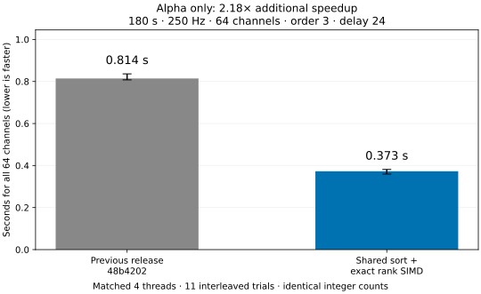

# Further acceleration: alpha only

**64 channels × 45,000 samples**, 180 seconds at 250 Hz, order=3.
Alpha band 8–13 Hz; midpoint 10.5 Hz; delay round(250/10.5)=24 samples (96 ms), below the 125 ms cap.
Tolerance is 0.2 × the population standard deviation of each filtered channel.
Both libraries use **4 threads** on the same machine through the same Python wrapper.
Method order is randomized across **11 timed repetitions**, after full-batch warm-up.
All reported times cover the whole 64-channel batch.

| Version | Median (s) | 25th percentile (s) | 75th percentile (s) |
| --- | ---: | ---: | ---: |
| Previous release `48b4202` | 0.8143 | 0.8075 | 0.8361 |
| Optimized | 0.3728 | 0.3595 | 0.3813 |

**Additional speedup: 2.18×**, or **54.2% less runtime** than the already optimized previous release.
This is a fresh, interleaved comparison against the previous library, not a ratio against an old timing from a different run.

## Changes

1. **Reuse one sort.** Delayed coordinates are shifted slices of the same signal. Sorting the full signal once and
   filtering the sorted indices produces all coordinate orders. Small template sets with very large delays retain the old approach.
2. **Exact radix sorting.** Finite IEEE binary64 values are ordered using their integer bit patterns. Original amplitudes
   are never modified. Other formats, small arrays and temporary-allocation failures retain comparison sorting.
3. **AVX2 ordinal-rank masks.** For order=3 with at most 65,536 templates, a supported CPU can construct
   neighborhood masks directly using exact 16-bit ranks. The ranks represent sorted positions, not rounded amplitudes.
   Floating-point radius boundaries are computed first, using the same inclusive distance comparisons as before.
   A wrapped integer subtraction reduces each rank-interval check to a single SIMD comparison.
4. **Keep portable fallbacks.** AVX2 and POPCNT are selected only after runtime feature checks. The prefix-bitset
   path remains available for other CPUs/sizes/orders and also benefits from shared/radix sorting.

No approximate matching, signal quantization, template subsampling or fast-math was introduced.
The public API, alignment, tolerance defaults and NaN conventions remain unchanged.

## Exactness and validation

Both uint64 pair-count arrays and the entropy vector matched the previous release exactly for all 64 channels
on every timed call. An independent aligned sklearn KDTree calculation verified both C3 counts.
[Retained counts](counts.json) and [raw individual timings](timings.json) are available.
The broader suite passed 172 tests, including signed-rank boundaries, the 65,536-template SIMD limit,
word padding, repeated values, signed zeros, subnormals and extreme finite doubles. Undefined-behavior,
address and leak checks also passed. The forced portable path passed its focused checks.
Exact integer counts are the primary cross-algorithm comparison; cross-platform logarithms need not be bit-identical.

## Timing conditions

Input validation, tolerance calculation, allocations, entropy computation and returning both count vectors are included.
Reading, resampling, alpha filtering, library initialization and warm-up are excluded.
The public resting EEG recording was resampled from 300 to 250 Hz using resample_poly(5,6), then filtered
using butter(N=4, bandpass=[8,13], output="sos") and sosfiltfilt on the complete eight-minute recording.
The first 180 seconds were selected afterward. Both libraries receive the identical resulting array;
the array SHA-256, CPU features, versions and library fingerprints are recorded in [metadata](environment.json).
Only alpha was benchmarked for this update. Speedups for other bands or hardware are not claimed.



Bars show median whole-batch runtime; whiskers show the 25th–75th percentiles.
[PNG](timings.png) · [SVG](timings.svg) · [Recording provenance/license](../data/README.md)

## Use

```sh
python build_c.py
```
Restart Python if the old shared library was already loaded. Your existing call stays the same:

```python
entropy = sample_entropy_c(eeg, order=3, delay=24, n_jobs=4)
```

## Reproduce

Build the baseline from its committed source without replacing the active checkout:

```sh
mkdir -p /tmp/sampen-alpha-baseline
git archive --format=tar --output=/tmp/sampen-alpha-baseline/source.tar 48b4202 csrc
tar -xf /tmp/sampen-alpha-baseline/source.tar -C /tmp/sampen-alpha-baseline
gcc -O3 -std=c11 -fPIC -shared -Wall -Wextra -Werror -fopenmp \
    /tmp/sampen-alpha-baseline/csrc/sampen.c -lm -o /tmp/sampen-alpha-baseline/baseline.so
python build_c.py
python -m pytest -q
python examples/benchmark_alpha.py \
    --source /path/to/eeg_resting_8min_300hz.fif \
    --baseline-lib /tmp/sampen-alpha-baseline/baseline.so
python examples/summarize_alpha.py
```
