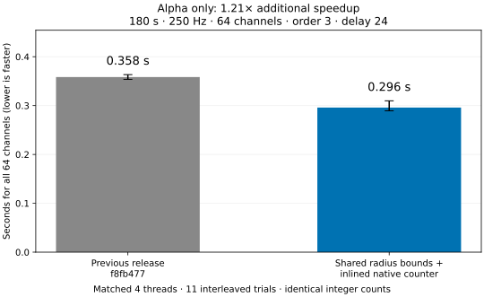

# Further alpha-only tuning: diminishing returns

**64 channels × 45,000 samples**, 180 seconds at 250 Hz, order=3, alpha 8–13 Hz.
Delay: 24 samples = 96 ms, below the 125 ms cap. Tolerance: 0.2 × each filtered channel population SD.
Both versions use 4 threads and the identical Python wrapper on the same machine.
11 timed repetitions per version, randomized method order after full-batch warm-up.

| Version | Median (s) | 25th percentile (s) | 75th percentile (s) |
| --- | ---: | ---: | ---: |
| Previous `f8fb477` | 0.3584 | 0.3537 | 0.3633 |
| Further optimized | 0.2960 | 0.2894 | 0.3098 |

**Additional speedup: 1.21×; 17.4% less runtime.** Times cover all 64 channels.
This is a fresh comparison against the immediately previous release, rather than a ratio against an old result.
Validation, radius calculation, allocations, entropy computation and returning both count vectors are included.
Reading, resampling, filtering, initialization and warm-up are excluded.

## Improvements retained

The previous implementation reused a signal sort, but searched radius endpoints again in every delayed coordinate.
The new implementation computes exact radius endpoints **once in the full sorted signal**. Prefix counts of valid
samples translate these endpoints into each delayed coordinate’s restricted sample interval. This also avoids
copying sorted coordinate views. Lower radius endpoints are derived from the symmetric upper-endpoint relation.
A low-memory/per-coordinate fallback remains available for sparse embeddings and failed optional allocations.

The native mask counter is now inlined into the AVX2/POPCNT channel routine. This removes per-query function
call/temporary-array overhead while retaining runtime CPU feature checks. Portable paths remain supported.

## Experiments not retained

Several coarse-template grouping variants were tested, including combinations with the final preprocessing change.
They added sorting and box-classification overhead; their small apparent gains were not convincing enough to
justify replacing the simpler verified path. Those experimental kernels are not shipped.
All empirical performance testing for this update used alpha only.

## Exactness

Both uint64 match-count arrays and entropy values matched the previous release exactly for all 64 channels on
every timed call. C3 match counts were independently verified with an aligned sklearn KDTree calculation.
The full suite passed 172 tests; undefined-behavior, address and leak checks passed, and forced portable-path
checks passed. No samples, template starts, precision settings, distance rules or tolerance defaults changed.
[Count vectors](counts.json) · [Individual timings](timings.json) · [Machine/code/input fingerprints](environment.json)

## What this says about the limit

The measured gains are diminishing on this machine, which has a four-CPU-equivalent quota.
These experiments do not prove an absolute speed limit. Wider SIMD hardware, more CPU cores, a GPU,
or a different exact counting algorithm remain possible avenues; their speedups were not measured here.
Performance depends on signal distribution, radius, compiler and hardware.



Bars show whole-batch medians; whiskers show the 25th–75th percentiles.
[PNG](timings.png) · [SVG](timings.svg) · [Recording attribution/license](../data/README.md)

## Reproduce

Build the previous library separately, without replacing the active checkout:

```sh
mkdir -p /tmp/sampen-alpha-baseline
git archive --format=tar --output=/tmp/sampen-alpha-baseline/source.tar f8fb477 csrc
tar -xf /tmp/sampen-alpha-baseline/source.tar -C /tmp/sampen-alpha-baseline
gcc -O3 -std=c11 -fPIC -shared -Wall -Wextra -Werror -fopenmp \
    /tmp/sampen-alpha-baseline/csrc/sampen.c -lm -o /tmp/sampen-alpha-baseline/baseline.so
python build_c.py
python -m pytest -q
python examples/benchmark_alpha.py \
    --source /path/to/eeg_resting_8min_300hz.fif \
    --baseline-lib /tmp/sampen-alpha-baseline/baseline.so \
    --baseline-commit f8fb4775b384d0217c93d980447efd49e28f6aa3 \
    --output examples/results_alpha_limit
python examples/summarize_alpha_limit.py
```

The recording/preprocessing is the same as the prior alpha-only benchmark: resample the complete pinned NeuroKit
recording from 300 to 250 Hz, use butter(N=4, bandpass=[8,13], output="sos") with sosfiltfilt on the complete
recording, then extract the first 180 seconds. Both libraries receive the identical resulting input array.
