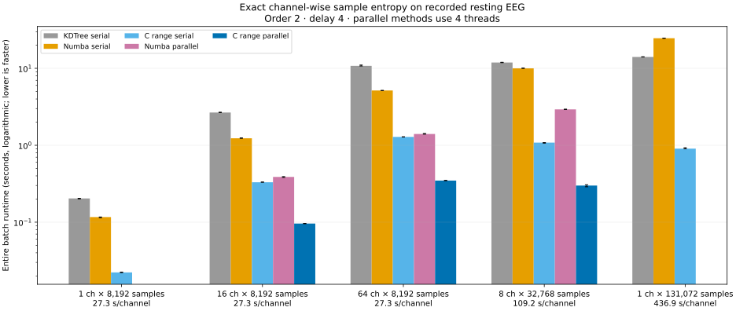

# Channel-wise C sample entropy: empirical benchmark

Real NeuroKit resting EEG at 300 Hz; order=2, delay=4, tolerance=0.2 × each channel SD.
All numbers below are **seconds for the whole channel batch**, not per-channel times.
Median of 3 timed calls after warm-up; method order randomized.
Parallel methods use 4 threads. The machine CPU quota is `400000 100000`
(quota/period in microseconds; 400000/100000 means four CPU equivalents).
Inputs are distinct recorded channels, not replicated synthetic data.

| Channels | Samples/channel | Seconds of EEG | KDTree 1 thread | Numba 1 thread | C range 1 thread | KDTree parallel | Numba parallel | C range parallel |
| ---: | ---: | ---: | ---: | ---: | ---: | ---: | ---: | ---: |
| 1 | 8,192 | 27.31 | 0.2036 | 0.1165 | 0.0222 | — | — | — |
| 16 | 8,192 | 27.31 | 2.6674 | 1.2334 | 0.3307 | 0.7517 | 0.3876 | 0.0960 |
| 64 | 8,192 | 27.31 | 10.7713 | 5.1537 | 1.2851 | 2.9641 | 1.4028 | 0.3476 |
| 8 | 32,768 | 109.23 | 11.9048 | 10.0120 | 1.0817 | 4.2529 | 2.9294 | 0.2996 |
| 1 | 131,072 | 436.91 | 14.0595 | 24.6424 | 0.9043 | — | — | — |

## Speedups

Ratios use the same input and include each public wrapper’s overhead.
Serial C comparisons isolate algorithm/language improvements; parallel comparisons use equal thread counts.

| Channels | Samples/channel | Serial C range vs serial Numba | Serial C range vs serial KDTree | Parallel C range vs parallel Numba | Parallel C range vs parallel KDTree |
| ---: | ---: | ---: | ---: | ---: | ---: |
| 1 | 8,192 | 5.24× | 9.16× | — | — |
| 16 | 8,192 | 3.73× | 8.07× | 4.04× | 7.83× |
| 64 | 8,192 | 4.01× | 8.38× | 4.04× | 8.53× |
| 8 | 32,768 | 9.26× | 11.01× | 9.78× | 14.19× |
| 1 | 131,072 | 27.25× | 15.55× | — | — |

## Serial algorithm comparison (seconds for whole batch)

| Channels | Samples/channel | Numba sweep | C sweep | C dual tree | C range counter |
| ---: | ---: | ---: | ---: | ---: | ---: |
| 1 | 8,192 | 0.1165 | 0.0589 | 0.0438 | 0.0222 |
| 16 | 8,192 | 1.2334 | 0.6084 | 0.5483 | 0.3307 |
| 64 | 8,192 | 5.1537 | 2.5469 | 2.1687 | 1.2851 |
| 8 | 32,768 | 10.0120 | — | 2.7489 | 1.0817 |
| 1 | 131,072 | 24.6424 | — | 3.5203 | 0.9043 |

C sweep is timed only for the 8,192-sample cases; dashes denote unrun comparisons.

## Correctness and limits

Every method was checked channel by channel against the aligned KDTree result, including every timed call.
Maximum absolute entropy difference: **0** (tolerance: rtol=atol=1e-12).
Both embedding dimensions use N − order × delay starts, inclusive Chebyshev radius, and no self matches.
The C backends count unordered pairs exactly; no approximate search, downsampling, or fast-math is used.

The default C backend for order=2 uses an exact dynamic range counter with O(N log² N) runtime and O(N log N) workspace.
The serial C sweep and dual-tree timings are also provided above to separate language effects from algorithm effects.
OpenMP adds independent channel parallelism.
Single-channel rows have no parallel measurements: channel parallelism cannot accelerate one channel.
Warm-up/JIT, reading the recording and C compilation are excluded. Validation, radius computation, allocations,
tree construction and the full entropy calculation are included. Parallel Numba uses a compiled `prange` loop;
parallel KDTree uses a persistent Python thread pool. C starts an OpenMP team for each call.

These are measurements on one recording, one parameter set and one shared cloud machine. They are not universal guarantees.
Sweep and dual-tree methods still have quadratic worst-case work; the order-2 range method avoids that bound.
More channels than available cores do not imply equal additional speedup.



Bars show whole-batch medians on a logarithmic time axis; whiskers are the 25th–75th percentiles of timed calls.
See [raw timings](timings.csv), [entropy vectors](entropies.json), [machine details](environment.json),
and [recording provenance/license](../data/README.md).

Reproduce (from the repository root, after downloading the pinned full FIF):

```sh
python build_c.py
python -m pytest -q
python examples/benchmark_channelwise.py --source /path/to/eeg_resting_8min_300hz.fif
python examples/summarize_channelwise.py
```
