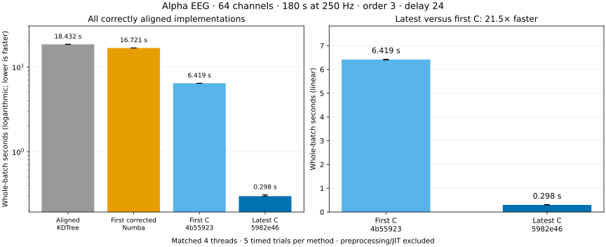

# First correct implementations versus latest C

**One identical empirical alpha EEG array:** 64 channels × 45,000 samples, 180 seconds at 250 Hz.
Band 8–13 Hz, order=3, delay=24 samples (96 ms, below the 125 ms cap), tolerance=0.2 × each channel population SD.
Every method uses the same **4-thread budget**.
Medians and quartiles come from 5 timed repetitions, in randomized method order, after full-batch warm-up.
All times are **seconds for the entire 64-channel batch**, excluding reading/filtering/resampling and JIT/startup.

| Implementation | Median (s) | 25th–75th percentile (s) | Latest speedup |
| --- | ---: | --- | ---: |
| Aligned KDTree reference | 18.4315 | 18.3661–18.5119 | 61.76× |
| First corrected Numba kernel (76fa55f) | 16.7208 | 16.7120–16.7698 | 56.03× |
| First C (4b55923) | 6.4188 | 6.3992–6.4337 | 21.51× |
| Latest C | 0.2984 | 0.2980–0.3097 | 1.00× |

## What “first correct” means

The earliest delay-aware corrected **Numba** implementation is archived from commit `76fa55f`.
Its unchanged counting kernel is wrapped in a compiled `prange` channel loop, giving it the same worker budget as C.
This adapter only adds batch validation, tolerance calculation and independent channel parallelism.
The original 1D API did not accept a channels-by-time array; a serial Python loop would be a different comparison.

The first correctly aligned channel-wise **C** implementation is compiled unchanged from commit `4b55923`.
It is loaded separately and called with its original supported `algorithm="tree"` through the same Python wrapper.
The latest C kernel is from native-code commit `5982e46` in this measured run, using `algorithm="auto"`.
Both C libraries use GCC -O3 with OpenMP, without fast-math or a global march=native option.

The aligned KDTree reference also uses the corrected template starts. This comparison does not use the
uncorrected legacy `sample_entropy()` output at delay>1.

## Numerical validation

Every timed entropy vector agreed with the aligned KDTree reference (maximum observed absolute difference: **0**).
Checks used rtol=atol=1e-12 and matching NaN positions; zero observed difference in this run is not a universal
cross-platform bitwise-equality guarantee.

The latest C uint64 counts for **both embedding dimensions** exactly matched independent KDTree counts for all 64 channels.
The historical first Numba/C APIs only return entropy, so direct raw-count access for those old binaries is not claimed.
[Counts and entropy](counts.json) · [All individual timings](timings.json) · [Environment and code fingerprints](environment.json)

## What is included

The measurements include wrapper work, tolerance calculation, allocations, template/tree construction where applicable,
and the complete entropy calculation. They time the entropy-only public C call, matching ordinary use.
The latest raw counts are obtained separately for validation. Full-batch warm-up is performed for every method.
Imports, Numba compilation, file reading, resampling and band filtering are excluded.

The public NeuroKit recording is resampled from 300 to 250 Hz using resample_poly(5,6), then filtered using
butter(N=4, bandpass=[8,13], output="sos") and sosfiltfilt on the complete eight-minute recording.
The first 180 seconds are selected afterward. Inputs are distinct recorded channels, not replicated signals.
See [recording provenance and license](../data/README.md). Results can vary with data and hardware.

Left: all implementations on a logarithmic time axis. Right: first C versus latest C on a linear axis.
Bars show batch medians; whiskers show the 25th–75th percentiles.
[PNG](timings.png) · [SVG](timings.svg)

## Build, use and reproduce

The [complete Python/C guide](../../docs/PYTHON_C_GUIDE.md) contains installation, data preparation, parameter definitions,
own-data timing, exact-count checks, troubleshooting and the historical-source compilation commands.
The benchmark entry point is `examples/benchmark_first_vs_latest.py`; the plot/report generator is
`examples/summarize_first_vs_latest.py`. Neither resets the active checkout.
